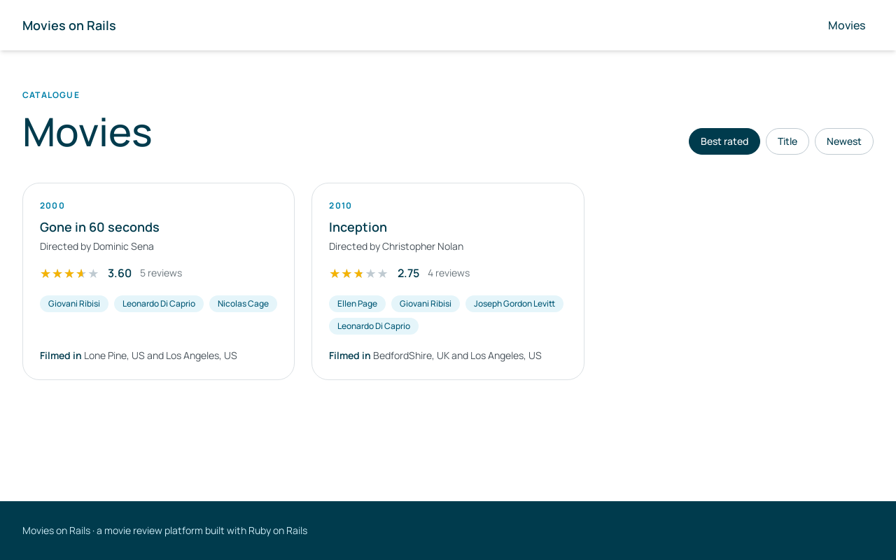
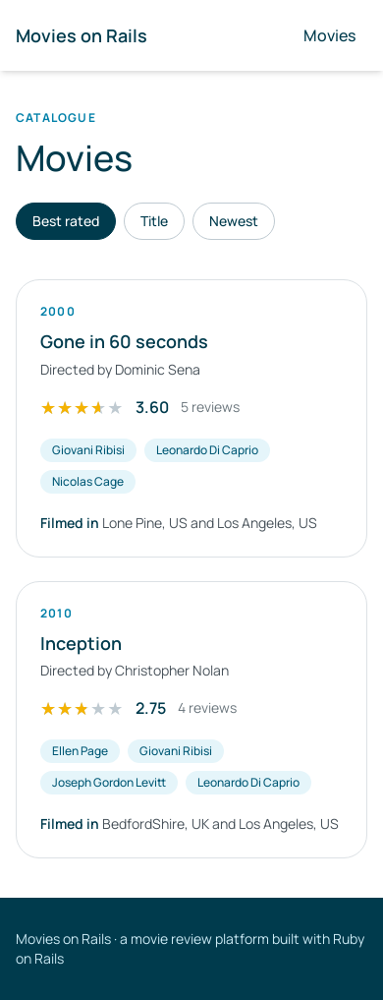
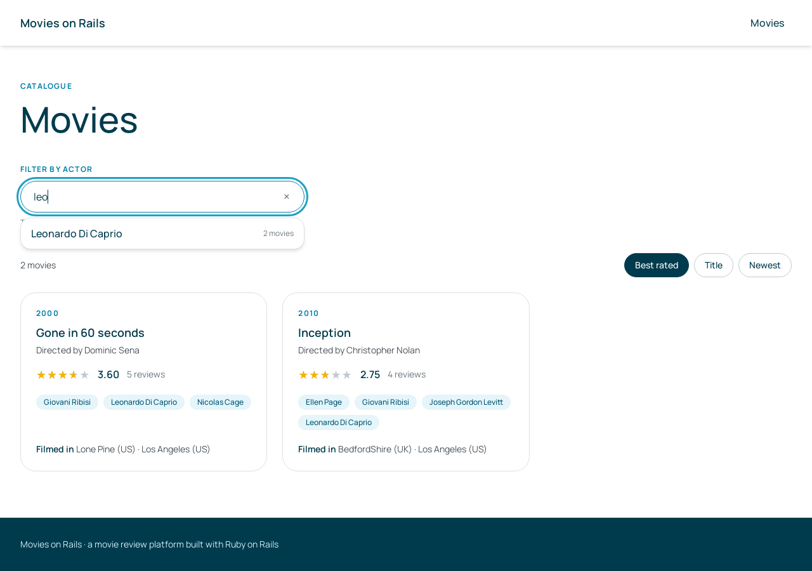
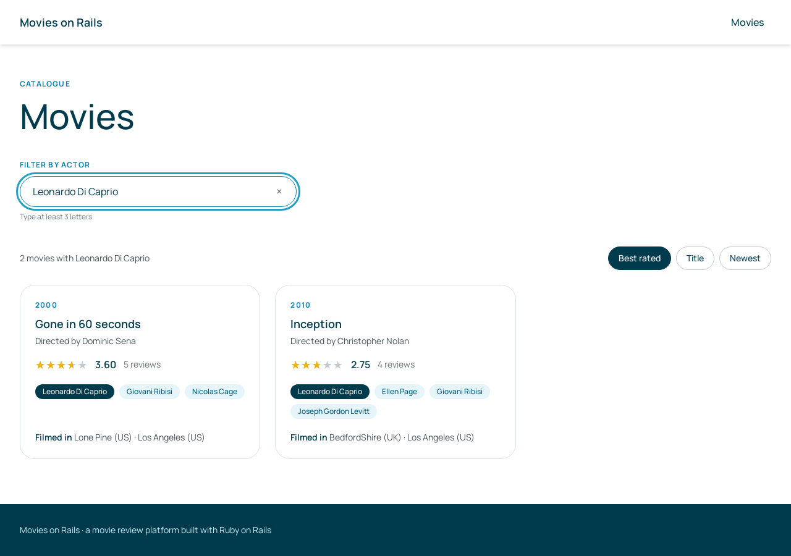
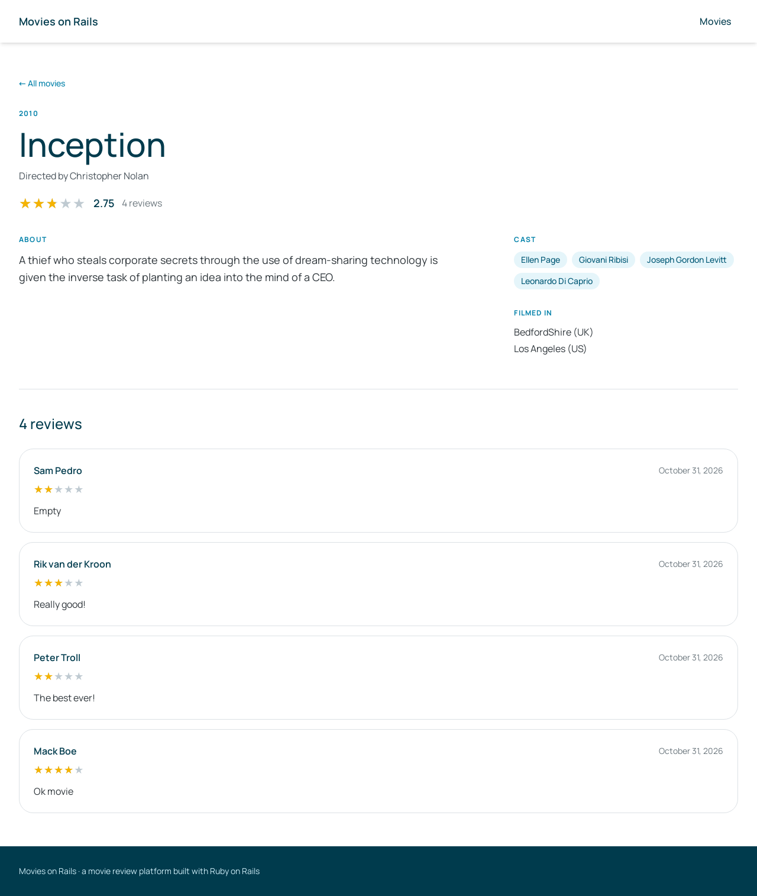
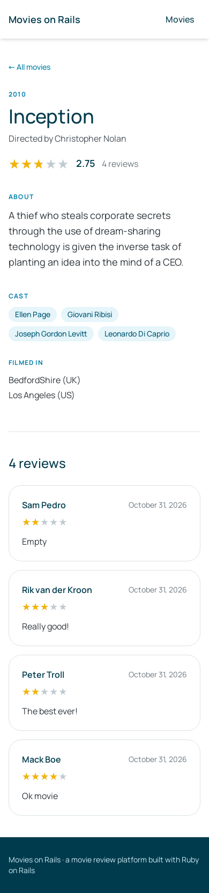
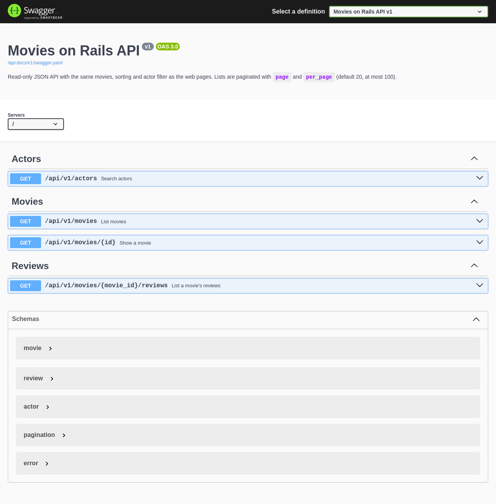
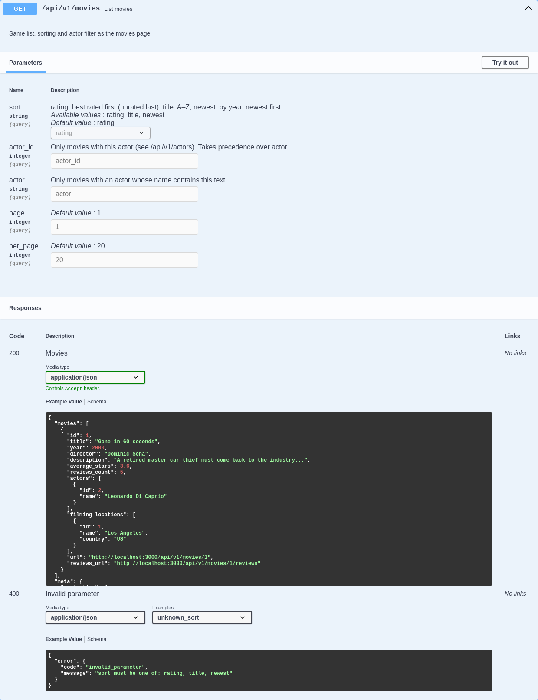

# Movies on Rails

> A movie review platform built with Ruby on Rails: two CSV files go in, and come out as a searchable, rated movie catalogue with a web interface and a JSON API.

The brief looked simple: import two small CSV files, list the movies, search them by actor, sort them by average rating and expose an API. The sample data has **2 movies and 9 reviews**.

I treated it as if the app were going to production and **thousands of people were going to use it at the same time**. One question shaped the whole design: *what happens when hundreds of people rate movies at the same moment while someone sorts the list by average stars?*

Answering that properly led to some interesting places:
- Postgres row locks and the deadlocks they can cause.
- A generated column backed by an index, so sorting by rating costs nothing.
- Streaming imports whose memory doesn't grow with the file size.
- Trigram indexes for searching an actor by any part of the name.
- An API documented by its own tests.

Even though it's a small project, it was a lot of fun to build. Every decision below came out of a real question during development, and each one is backed by a test, a benchmark or an `EXPLAIN` plan.

**Highlights**

- ⭐ **Sorting by average stars costs an index read.** The average is a stored generated column, kept exact under concurrent writes by atomic increments in Postgres, with no Redis lock.
- 📥 **One import command for any CSV.** The file kind is detected from its headers. Files are streamed in batches of 1,000 rows, so memory stays flat (+5 MB) from 20k to 200k reviews. Imports run in Sidekiq on a dedicated queue.
- 🔎 **Actor search as you type.** Matches any part of the name ("leo" → Leonardo Di Caprio, Cleo Smith). A trigram index serves it in **0.02–2.6 ms over 200,000 actors**.
- 🧩 **The web pages and the JSON API share the same query objects**, and parity specs prove they return the same movies in the same order.
- 🧪 **430 RSpec examples**, including concurrency specs with real threads. Each spec that guards a fix was checked to fail without the fix, and CI runs lint, security scans and the suite on every PR.
- 🧭 **Built in public-repo style.** Over 120 commits, one GitHub issue per task, one PR per feature, Conventional Commits and code split from its tests.

---

## Contents

- [What it does](#what-it-does)
- [Screenshots](#screenshots)
- [Importing the CSV files](#importing-the-csv-files)
- [The JSON API](#the-json-api)
- [Decisions and why](#decisions-and-why)
- [Evidence](#evidence)
- [Testing](#testing)
- [How the project was built](#how-the-project-was-built)
- [Future improvements](#future-improvements)
- [Stack](#stack)

---

## What it does

| Brief requirement | How it's delivered |
|---|---|
| Rails app with a database schema | PostgreSQL schema with movies, actors, filming locations, the join tables, reviews and an `imports` log, with constraints at the database level ([`db/schema.rb`](db/schema.rb)) |
| Import both CSV files | `bin/rails import:csv`: one command for both files, kind detected from the headers, processed in Sidekiq |
| Movie overview | Card list, 12 per page, each card with the rating, director, cast and filming locations; a page per movie with its reviews |
| Search by actor | A field with suggestions from 3 letters; pick an actor or press Enter to filter by the typed text |
| Sort by average stars, efficiently | Default sort, read straight from an index on a stored generated column (`average_stars`) |
| API endpoint | Read-only JSON API v1 with the same sorting and filters, documented with OpenAPI at `/api-docs` |

## Screenshots

**Movie list, best rated first**

 

**Actor search: suggestions as you type, then the filtered list**

 

**Movie page with its reviews, newest first**

 

**API docs (Swagger UI at `/api-docs`)**



## Importing the CSV files

The two files from the brief are in the repository root: [`movies.csv`](movies.csv) and [`reviews.csv`](reviews.csv).

```bash
# Queue the import in Sidekiq (the worker runs with bin/dev)
bin/rails import:csv FILES="movies.csv reviews.csv"

# Or run it right in the terminal and see the report
bin/rails import:csv FILES="movies.csv reviews.csv" INLINE=1

# The latest imports, their status and failed rows
bin/rails import:status

# Rebuild every movie's rating from its reviews (a safety net, never needed in normal use)
bin/rails ratings:recalculate
```

Output of an inline import on an empty database:

```
movies movies.csv: completed, 14 rows, 0 failed
reviews reviews.csv: completed, 9 rows, 0 failed
```

**What happens under the hood**

- **Any order, any names.** The kind of each file is detected from its **headers**, not from its name, and movies are always imported before reviews. An unknown file is rejected up front, and the error lists the accepted formats.
- **Streamed in batches of 1,000 rows,** so memory doesn't grow with the file size.
- **Each row is validated with the model rules** (`valid?(:import)`). Invalid rows don't stop the import: they're recorded with their **line number** and shown by `import:status`.
- **Bulk inserts** (`insert_all`) with the database enforcing uniqueness. Actors and locations are matched case-insensitively ("new york" is "New York").
- **A file can't be imported twice.** The import is identified by the file's SHA-256 checksum, so running the same command again skips the file instead of duplicating reviews. A failed import can be retried.
- **In Sidekiq** the import runs on the `imports` queue, with lower priority than everything else, so a big file never holds up other work. It has no automatic retries, because a retry after a partial reviews import would duplicate rows. The Sidekiq dashboard is at `/sidekiq`, protected by Basic Auth (`SIDEKIQ_USERNAME` / `SIDEKIQ_PASSWORD`).

## The JSON API

Read-only, versioned under `/api/v1`, and documented with OpenAPI (Swagger UI at **`/api-docs`**).

| Endpoint | Parameters | Returns |
|---|---|---|
| `GET /api/v1/movies` | `sort` (`rating` default, `title`, `newest`), `actor`, `actor_id`, `page`, `per_page` (20, max 100) | Movies, plus `meta` with the pagination and the filters actually applied |
| `GET /api/v1/movies/:id` | — | One movie with its whole cast and filming locations |
| `GET /api/v1/movies/:movie_id/reviews` | `page`, `per_page` | The movie's reviews, newest first |
| `GET /api/v1/actors` | `q` (3+ characters) | Matching actors, each with a movie count and a link to their movies |

```bash
curl "http://localhost:3000/api/v1/movies?actor=leo&sort=title&per_page=1"
```

```json
{
  "movies": [
    {
      "id": 1,
      "title": "Gone in 60 seconds",
      "year": 2000,
      "director": "Dominic Sena",
      "description": "A retired master car thief must come back to the industry and steal fifty cars...",
      "average_stars": 3.6,
      "reviews_count": 5,
      "actors": [ { "id": 3, "name": "Giovani Ribisi" }, { "id": 2, "name": "Leonardo Di Caprio" }, { "id": 1, "name": "Nicolas Cage" } ],
      "filming_locations": [ { "id": 2, "name": "Lone Pine", "country": "US" }, { "id": 1, "name": "Los Angeles", "country": "US" } ],
      "url": "http://localhost:3000/api/v1/movies/1",
      "reviews_url": "http://localhost:3000/api/v1/movies/1/reviews"
    }
  ],
  "meta": {
    "pagination": { "page": 1, "per_page": 1, "pages": 2, "count": 2, "next_page": 2, "prev_page": null },
    "filters": { "sort": "title", "actor_id": null, "actor": "leo" }
  }
}
```

- **Filtering by actor:**
  - `actor=leo` matches any actor whose name **contains** "leo", in any case.
  - `actor_id=2` matches **that exact actor**. Get the id from `GET /api/v1/actors?q=leo`; each actor comes with a `movies_url` that already points to this filter.
- **Field meanings:**
  - `average_stars` is `null` for a movie without reviews, and those movies come last in the rating sort.
  - `meta.filters` shows what was actually applied. For example, `actor` is `null` when `actor_id` took precedence.
- **Errors** share one shape, for example `{ "error": { "code": "invalid_parameter", "message": "sort must be one of: rating, title, newest" } }`.
  - **400** for an invalid filter: an unknown `sort`, an `actor_id` that isn't a positive integer, or an `actor`/`q` shorter than 3 characters. An invalid filter is rejected instead of silently ignored, so a typo can't return the whole catalogue as if it were filtered.
  - **404** for an unknown movie.



## Decisions and why

### Data model

- **Normalized schema.** Actors and filming locations are their own tables, linked to movies through `MovieActor` and `MovieFilmingLocation`. These are the Rails join-model names; "Casting" would read as "the whole cast". Uniqueness and foreign keys are enforced by the database, not only by validations.
- **Actor and location names are `citext`** (case-insensitive text). "leonardo di caprio" finds "Leonardo Di Caprio" with plain ORM lookups and a regular unique index, while the original casing is kept for display.
- **No redundant indexes.** `movie_actors` has a unique `(movie_id, actor_id)` index, which already serves lookups by `movie_id` as its leftmost column (checked with `EXPLAIN`). An extra `movie_id` index would only slow down every insert.
- **Business rules live in the models:**
  - a movie's year runs from **1888** (*Roundhay Garden Scene*, the oldest surviving film) to the current year, and every movie field is required;
  - stars are an integer from **0 to 5**;
  - a review's text is optional, since the sample has a review whose text is literally "Empty", stored as given.
- **No uniqueness on the reviewer per movie.** The reviewer is just a name, and different people can share one. Real users, with identity, are a future improvement.
- **Deleting rules:**
  - deleting a movie deletes its reviews and its links to actors and locations;
  - an actor or location still used by a movie **can't be deleted** (`restrict_with_error`).

### Sorting by average stars under concurrency

This was the central question of the project. Computing `AVG(stars)` on every page view doesn't scale, and a cached average is only useful if it stays exact while many people rate at once.

- **The data:** each movie keeps two counters, `ratings_sum` and `ratings_count`. `average_stars` is a **stored generated column** (`ratings_sum / ratings_count`, rounded to 2 decimals, `NULL` without reviews) with an index `(average_stars DESC NULLS LAST, id DESC)`. Postgres keeps the average up to date by itself, and the list just reads the first 12 entries of the index, with no sorting in memory.
- **The writes:** new ratings are added with **atomic increments** (`SET ratings_sum = ratings_sum + x`) in the same transaction as the reviews. Postgres locks the movie's row, so concurrent writers queue for about a millisecond, each one adds on top of the latest value, and no rating is lost. It's the same idea as Rails' `counter_cache`.
- **Why not a Redis lock?**
  - The lock would live outside the database transaction. A crash or an expired lock could let two writers in, or Redis could say "ok" while the database fails.
  - It would make Redis a hard dependency for writing a review.
  - At much larger scale (millions of ratings per minute on the same movie), the next step would be Redis `INCR` counters flushed to the database, or aggregation through a queue. That's far more complexity than this volume justifies.
- **Lock type:** movies are locked with **`FOR NO KEY UPDATE`**, not `FOR UPDATE`. Inserting a review takes a `FOR KEY SHARE` lock on its movie for the foreign-key check, and `FOR UPDATE` conflicts with it. The first version deadlocked under parallel imports; the concurrency spec caught it before it was ever committed.
- **Lock order:** rows are locked in **id order**, and every bulk insert is sorted by its unique key, so parallel imports always take locks in the same order and can't deadlock each other.
- **Safety net:** `bin/rails ratings:recalculate` rebuilds every counter from the reviews, and it can run alongside imports.

### Import pipeline

- **One entry point.** A detector reads each file's headers and picks the importer. A dispatcher checks every file before starting, then runs movies before reviews.
- **Streaming:** `CSV.foreach` in batches of 1,000 rows, never the whole file in memory.
- **Validation:**
  - every row goes through the model validations in an `:import` context;
  - uniqueness checks are left to the database, which avoids one query per row;
  - failures are stored with their line numbers, capped at 1,000.
- **An existing movie is left untouched:** the first imported data wins. Its new actors and locations are still found or created, and linked.
- **The same file can't run twice at the same time, or again after completing:** a partial unique index on the file checksum among running and completed imports. This was found by a threaded spec where two parallel runs of the same file duplicated reviews.
- **Sidekiq queues are weighted:**

  | Queue | Weight | Used for |
  |---|---|---|
  | `critical` | 6 | Work that must never wait |
  | `default` | 3 | Generic jobs |
  | `imports` | 2 | CSV imports |
  | `low` | 1 | Low-priority work |

- **Seeds stay empty.** Data comes from the import, and the specs run the import themselves.

### Searching by actor

- **"Contains" search** (`ILIKE '%leo%'`), with names that **start** with the text listed first.
- **A trigram GIN index** on the name serves it. A regular B-tree can't help with "contains".
- **Minimum of 3 letters**, because a trigram needs 3 characters: with 2 letters the index can't be used. The field also waits for a pause in typing (debounce) before asking the server.
- **Top 10 first, then count:** the 10 matching actors are picked first, and the movies are counted only for those 10. Counting for every match and then taking 10 was up to **12 times slower**.
- **The filter itself** uses a subquery (`WHERE id IN (SELECT movie_id ...)`), so a movie with two matching actors appears once and the rating index keeps serving the sort.

### Web interface

- **Hotwire:**
  - **Turbo Frames** update only the list when filtering, sorting or paging;
  - the URL follows each change, so every state can be shared;
  - **Stimulus** drives the actor field, with the `stimulus-autocomplete` package.
- **Visual identity** inspired by [SCOR Digital Solutions](https://www.scordigitalsolutions.com/) (colors, type, cards) through Tailwind theme tokens. The interface is in English and responsive.
- **Every text comes from I18n** (`config/locales/en.yml`). Missing translations raise errors in development and test, so a hardcoded string can't slip through.
- **No N+1 queries:** casts and locations are preloaded, and specs check that the query count doesn't grow with the data.

### API

- **`ActionController::API`** (no session, cookies or CSRF) with Jbuilder views, read-only, versioned under `/api/v1`.
- **Same query objects as the pages** (`MovieSearch`, `ActorSearch`), so the API can't drift from the interface. Parity specs prove it.
- **Strong parameters in each controller.** Pagination reads only the permitted parameters.
- **Documented by its own tests:** rswag specs generate the OpenAPI file and validate every response against a **strict schema** (every property required, none extra). CI fails if the committed docs are out of date.

### Code organization

- **Services** (`app/services/`) for processes, such as the importers and the ratings recalculator.
- **Query objects** (`app/queries/`) for searches, such as `MovieSearch` and `ActorSearch`.
- **Rails-documented query methods** (scopes, `where("... ?", value)`, `sanitize_sql_like`) instead of hand-built SQL. Arel appears only where Rails has no documented way: the per-movie bulk increment, built with a `CASE`, which keeps Brakeman clean.
- **Configuration and secrets stay out of the code:**
  - `config/database.yml` and `.env` are git-ignored;
  - `config/database.example.yml` and `.env.example` are versioned templates.

## Evidence

**Import performance** (local machine; reviews spread across 500 movies)

| Scenario | Time |
|---|---|
| 2,000-line reviews CSV | **0.44 s** |
| 20,000 reviews, 1 import | **5.4 s** |
| 50,000 reviews, 1 import | **12.3 s** |
| 200,000 reviews, 1 import | **50.7 s** (~3,950 rows/s) |
| 6 parallel imports, 50,000 reviews in total | **10.8 s** |
| Peak memory, any size | **+5 MB** (flat) |

These numbers come from a later optimization: each batch now updates all its movies' ratings in a single query, instead of one query per movie. That **halved** the import time (200k reviews: 106 s → 50.7 s) and made parallel imports **2.6× faster**.

**Correctness under concurrency:** after 6 parallel imports of 50,000 reviews, **0 movies have wrong counters**, and **0 of 500 averages** differ from `ROUND(AVG(stars), 2)` computed straight from the reviews.

**Actor search** (`EXPLAIN ANALYZE`, 200,000 realistic names)

| Search | Without the index | With the trigram index |
|---|---|---|
| "leo" (1,252 matches) | 54 ms | **2.6 ms** |
| "smith" (855) | 57 ms | **2.2 ms** |
| "leonar" (182) | 53 ms | **0.6 ms** |
| "xyz" (0) | 60 ms | **0.02 ms** |

**Index usage is confirmed with `EXPLAIN`** for:
- the rating sort (an index scan, no sort step);
- the actor filter subquery;
- the actor search;
- a movie's reviews, newest first, from a `(movie_id, created_at DESC, id DESC)` index, so a page of reviews never sorts in memory.

## Testing

```bash
bin/rspec                 # 430 examples
bin/rubocop               # style (rubocop-rails-omakase + rspec, factory_bot, capybara)
bin/brakeman --no-pager   # security
```

- **Tools:**
  - **RSpec** only, with FactoryBot, Faker and shoulda-matchers;
  - **Capybara + Cuprite** (headless Chrome) for system specs;
  - Active Job matchers for jobs.
- **Concurrency specs use real threads and connections.** They cover parallel imports, the same file imported twice at once, and the ratings recalculation running alongside imports. Each one was confirmed to **fail on the code before its fix** (deadlocks, duplicated reviews).
- **Mutation-checked filters.** The API filter specs were run against deliberately broken code: no `%`/`_` escaping, no actor filter, a JOIN instead of the subquery, no tie-break. Each break makes a spec fail.
- **Every generated spec is completed.** CI fails if a generator placeholder (`pending "add some examples..."`) is left behind.
- **CI on every PR** (GitHub Actions):
  - RuboCop, Brakeman, importmap audit;
  - the suite against PostgreSQL 17 and Redis 7, on a database loaded from the schema only;
  - the API docs freshness check.

## How the project was built

The brief grades version control, so the history is meant to be read:

- **One GitHub issue per task** and one PR per feature. Each PR has a description, screenshots for UI changes and a green CI, and is merged with **rebase**, so every commit lands on `main`.
- **Conventional Commits** (`feat`, `fix`, `refactor`, `perf`, `test`, `docs`, `chore`, `ci`). Code and its tests go in separate commits, and commits reference their issue.
- **Rails generators** for every model, migration, controller and job. Migrations are never edited after being merged.
- **Small, reviewable steps:** each model, the import, the ratings cache, the list, the search, the movie page and the API were separate PRs (see the [closed pull requests](https://github.com/GiuseppeVarriale/movie-on-rails/pulls?q=is%3Apr+is%3Aclosed)).

## Future improvements

- **Admin screen to import files.** An authenticated page to upload the CSVs, which would be processed in the background through the same Sidekiq queue (`imports`). It could show each import's progress and failed rows, reusing the `Import` records the rake task already writes.
- **Let people rate movies.** The hard part is already done: ratings are updated atomically and the sort stays exact under concurrency. What's left is a form on the movie page and a controller action that creates the review and adds its stars with the same atomic increment. Real users with authentication would then allow one review per person.
- **Token authentication for the API**, if it becomes private. **Doorkeeper** (OAuth 2) or a similar solution would let external apps get tokens, with scopes such as read-only access.
- **Rate limiting** for the API and the actor suggestions. Rails 8's built-in `rate_limit`, backed by the Redis cache store, would be shared across servers.
- **Live updates.** With the review form in place, Turbo Streams over Action Cable could refresh ratings on open pages, throttled so that hundreds of ratings at once don't flood the browsers.
- **Docker Compose** to start everything (Postgres, Redis, web, worker) with one command. It would also set the same database collation everywhere and use jemalloc to keep the Sidekiq worker's memory stable after big imports.
- **Content Security Policy** and the remaining security hardening.

## Stack

| | |
|---|---|
| Language and framework | Ruby 4.0, Rails 8.1 |
| Database | PostgreSQL (`citext`, `pg_trgm`, generated columns, partial indexes) |
| Background jobs | Sidekiq 8 on Redis |
| Front end | Hotwire (Turbo + Stimulus), Tailwind CSS, importmap |
| API | Jbuilder, OpenAPI with rswag |
| Pagination | Pagy |
| Tests | RSpec, FactoryBot, Faker, shoulda-matchers, Capybara + Cuprite |
| Quality | RuboCop, Brakeman, GitHub Actions |

> Setup instructions (running locally and with Docker Compose) will be added in the next version of this README.
